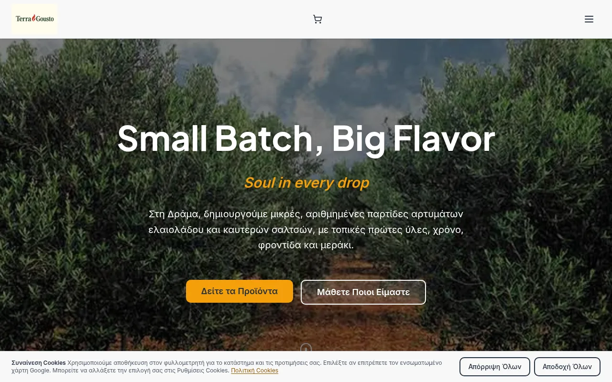

# Robo Portfolio

[](https://app.netlify.com/projects/robo-portfolio)

> Έργα που δουλεύουν σε παραγωγή — όχι mockups. Five live web applications
> designed and built by RoboD3v in Greece: e-shop, IQ test, artist portfolio,
> learning platform, political quiz.

**Live: [portfolio.robod3v.com](https://portfolio.robod3v.com)**



## Features

- **Everything clickable-live** — each project links to its production URL;
  tiles show auto-refreshed hero screenshots (monthly Playwright capture).
- **Money / Brains / Beauty / Platform / Viral** — filterable bento grid:
  Medusa e-shop with card + cash-on-delivery checkout, adaptive IRT IQ
  engine, cinematic 3D artist portfolio, plus learning platform and viral quiz.
- **Two deep case studies** (terragousto, lab): Problem → Build → Live proof,
  architecture mini, timeline — desktop dialog, bottom-sheet on mobile.
- **Zero tracking** — no cookies, no analytics; privacy-by-design copy and
  headers (strict CSP, HSTS preload).
- **Fast by construction** — prerendered single route, ~45KB initial JS,
  Lighthouse targets perf≥90 / a11y≥95 (manual run, see CONTENT_SEO_PLAN.md).

## Quick Start

```bash
npm install --include=dev
npm run dev        # http://localhost:5173
npm run build      # typecheck + vite + prerender → dist/
```

See [AGENTS.md](AGENTS.md) for verification commands and guardrails.

## The five projects

| Project | What | Live |
|---|---|---|
| Terragousto | E-shop, olive oils & hot sauces (Medusa v2) | https://terragousto.gr |
| Lab | Free Greek IQ test, adaptive IRT scoring | https://greek-iq-app.vercel.app |
| Plaisiore | 3D artist portfolio, 17 works | https://plasiore.netlify.app |
| RoboSchool | Learning platform, 7 tracks / 65 lessons | https://school.robod3v.com |
| Political Compass | Greek 40-question political quiz | https://robo-political-compass.vercel.app |

Automations & AI agents live on [robod3v.com](https://robod3v.com) —
this portfolio intentionally shows shipped web apps only.

<details>
<summary>Advanced: preview refresh & SEO/GEO</summary>

- `npm run capture-previews` — Playwright captures (1280×800) of the 5
  heroes → `public/previews/` + `previews.json` dates (also monthly via
  GitHub Actions + Netlify build hook).
- `npm run prerender` — SSR single route into `dist/index.html`
  (canonical + Person/ItemList JSON-LD).
- `npm run llms-full` — builds `public/llms-full.txt` from page data.
- Design decisions: `docs/superpowers/specs/2026-10-16-portfolio-design.md`.

</details>

<details>
<summary>Local Development & Contributing</summary>

```bash
git clone https://github.com/GS-RoboD3v/robo-portfolio.git
cd robo-portfolio
npm install --include=dev && npm run dev
```

Read [AGENTS.md](AGENTS.md) before changing anything (boundaries, budgets,
no-invented-metrics rule). `npx vitest run`, `npm run lint` must stay green.

</details>

## License

No license file yet — all rights reserved.
